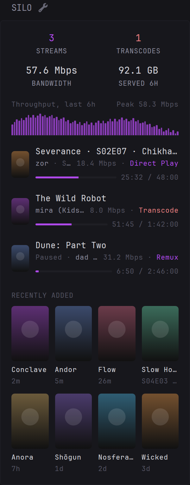
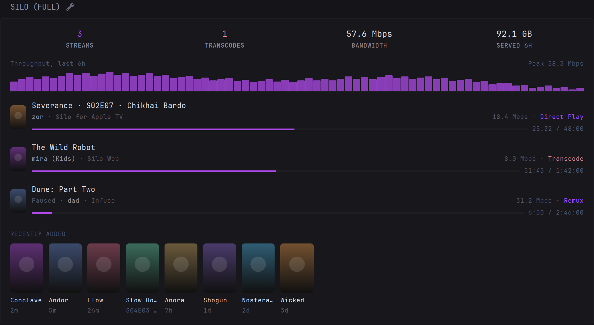

# Silo

Activity from a [Silo](https://github.com/Silo-Server/silo-server) media server:

- Summary: active streams, transcodes, the combined bitrate of the active streams, and the data served in the chart's window.
- Throughput chart: viewer egress over the last 6 hours, with the peak.
- One row per stream: title (`Series · S02E07 · Episode` for episodes), user and profile, client, bitrate, play method (`Direct Play`, `Direct Stream`, `Remux` or `Transcode`), and progress. Paused streams are marked.
- Recently added: the 8 newest movies and series, with posters and how long ago they arrived. Each poster links to the title in Silo.





## Requirements

- Silo with the `/api/v2` API.
- An API key created by an administrator account, scoped to `admin:monitor:read` and `catalog:read`.

### Create the API key

In Silo, open Admin, API Keys, and create a key with **Selected scopes**:

- `admin:monitor:read`: live sessions and the throughput history. It returns no file paths, node addresses or credentials, and cannot control playback.
- `catalog:read`: the recently added list, read as one profile.

The key cannot play media, change settings or manage users. Admin scopes only work on a key owned by an admin account.

### Find the profile ID

Recently added is read as a profile, so the widget sends its ID. With the key:

```sh
curl -H "Authorization: Bearer $SILO_API_KEY" "$SILO_URL/api/v2/profiles"
```

Use the `id` of the profile whose libraries you want to show, usually the primary one. The list respects that profile's library access and rating limits.

## Environment variables

| Variable | Description |
|----------|-------------|
| `SILO_URL` | Address Dynacat reaches Silo on, without a trailing slash, e.g. `http://silo:8080` |
| `SILO_API_KEY` | The scoped API key (starts with `sa_`) |
| `SILO_PROFILE_ID` | The profile ID for recently added |

## Configuration

```yaml
- type: dynawidgets
  widget: silo
  headers:
    Authorization: Bearer ${SILO_API_KEY}
  cache: 30s
```

The `required:` section supplies the URLs and the headers of the two extra requests (throughput and recently added), so only the first request's `Authorization` header goes in your config.

Poster links use the address in `SILO_URL`. If that is an internal address, set the one your browser uses:

```yaml
- type: dynawidgets
  widget: silo
  headers:
    Authorization: Bearer ${SILO_API_KEY}
  options:
    public-url: https://silo.example.com
```

### Changing the chart window or the recently added list

To change one of the extra requests, redefine it under `subrequests` in full, headers included. For a 24 hour chart:

```yaml
- type: dynawidgets
  widget: silo
  headers:
    Authorization: Bearer ${SILO_API_KEY}
  subrequests:
    throughput:
      url: ${SILO_URL}/api/v2/admin/stats/timeseries
      headers:
        Authorization: Bearer ${SILO_API_KEY}
      parameters:
        hours: 24
```

`hours` accepts 1 to 744. Silo samples once a minute and returns 5 minute buckets up to 48 hours, then wider ones; each bar is the peak of its bucket.

For new episodes instead of movies and series, set `type: episode` on the `recent` subrequest:

```yaml
subrequests:
  recent:
    url: ${SILO_URL}/api/v2/catalog
    headers:
      Authorization: Bearer ${SILO_API_KEY}
      X-Profile-Id: ${SILO_PROFILE_ID}
    parameters:
      type: episode
      sort: -added_at
      limit: 8
      skip_total: true
      image_size: small
```

## Behavior notes

- Bandwidth is the sum of each stream's measured bitrate. When Silo has no measurement yet, the stream's target bitrate counts, then its source bitrate.
- Served is the viewer egress Silo measured over the chart window. Silo calls it a close estimate, not byte-exact accounting.
- Silo answers the stats reads of a scoped key from a shared cache (up to 30 seconds old), so a `cache` below `30s` does not make the chart fresher.
- Posters are fetched by Dynacat and served from it; the browser does not contact Silo.
- When nothing is playing, the widget shows "Nothing is playing" and keeps the summary, chart and recently added.

## Troubleshooting

Test each request from the Dynacat host:

```sh
curl -H "Authorization: Bearer $SILO_API_KEY" "$SILO_URL/api/v2/admin/sessions"
curl -H "Authorization: Bearer $SILO_API_KEY" "$SILO_URL/api/v2/admin/stats/timeseries?hours=6"
curl -H "Authorization: Bearer $SILO_API_KEY" -H "X-Profile-Id: $SILO_PROFILE_ID" "$SILO_URL/api/v2/catalog?sort=-added_at&limit=8&type=video"
```

- `401`: the key is wrong or revoked.
- `403 permission_denied`: the key lacks a scope, or its owner is not an admin.
- `422` on the catalog request: `SILO_PROFILE_ID` is missing or not a profile on the key's account.

A failure in any of the three requests shows as an error on the whole widget.

For Silo behind a self-signed HTTPS certificate, add `allow-insecure: true` to the widget and to both subrequests, redefining them as shown above.
